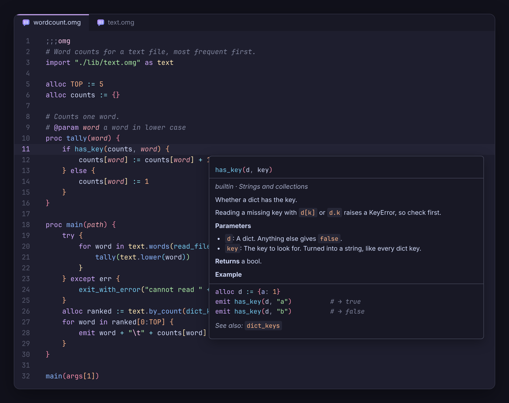
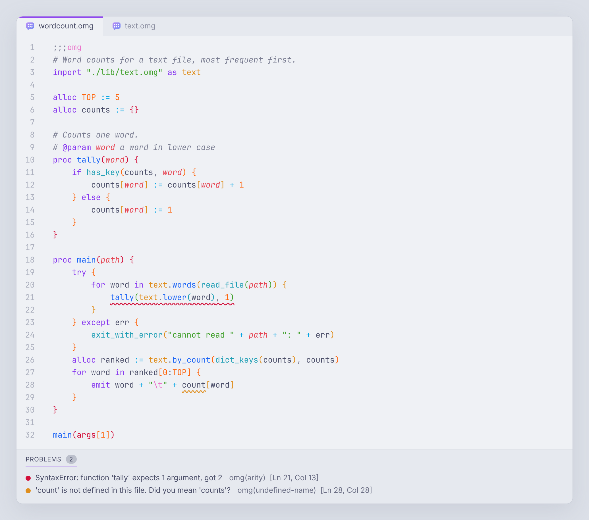

# OMG for VS Code

Everything for writing [OMG](https://versyx.digital/omglang/) in VS Code:
colouring that knows what each name is, documentation on hover, completion,
go to definition, rename, formatting, and the compiler's own errors as you
type. It needs nothing installed: the language server is part of the
extension, and it understands OMG by itself.



<sub>The pictures on this page are drawn by `scripts/preview.mjs` from the
extension's own grammar, themes and language server, so they change when
those do. The frame around the code is only an illustration.</sub>

## What you get

### Documentation on hover

Point at anything and it explains itself.

- **Builtins**: all 70, each with its signature, what every parameter is,
  what comes back, which errors it raises, and an example. The examples are
  run through `omg` by the test suite, so the output shown is the real
  output.
- **Keywords and operators**: what `alloc`, `loop`, `facts`, `:=`, `//` and
  the rest do, with the rules that catch people out (no block scope, `for`
  walks lists and strings but not dicts, which values count as false).
- **Your own code**: a proc shows its signature and the comment above it.
  `# @param name ...` and `# @return ...` lines are picked out. A variable
  shows where it was declared and what it holds; an imported module lists
  what it exports; a dict entry shows its value.
- **Numbers**: an integer literal in decimal, hex and binary.

### Completion and signature help

- After a dot: the procs and variables of an imported module, or the keys
  of a dict, including a dict returned by a proc in another file.
- Everywhere else: what fits. Statement keywords at the start of a line,
  only values inside an expression, `as` after an import path, `in` after
  `for x`, file names inside an import string, and nothing at all when you
  are naming a new variable.
- Inside a call: the parameters, with the one you are typing marked, for
  builtins and for your own procs.

### Problems, as you type

Syntax errors appear with the same message and on the same line as
`omg` would report them, because the language server runs a port of the
compiler's own lexer and parser. The test suite checks this by breaking
real files in hundreds of ways and comparing the two.

It also reports what the compiler would only tell you at run time, or
never:

| | |
|---|---|
| Wrong number of arguments | to a proc, to a builtin, or through a module |
| A name that does not exist | with a "did you mean" and a quick fix |
| Assigning without `alloc` | with a quick fix that adds it |
| `alloc` of the same name twice | with a quick fix that turns it into an assignment |
| A proc named like a builtin | calls would run the builtin, never your proc |
| `return`, `break`, `continue` in the wrong place | |
| Imports that cannot be found, or import each other in a circle | |
| Writing to an imported module, or reading something it does not export | |
| Words from other languages (`while`, `def`, `null`, ...) | with the OMG way to say it |
| Unused variables, parameters and imports; code after a `return` | faded, not underlined |



### Getting around

- **Go to definition** and **find all references**, across files and into
  dict literals. Ctrl+click an import path to open the file.
- **Rename** a proc, variable, parameter or dict key everywhere it is
  used, in every file that imports it. A rename that would collide with
  another name is refused.
- **Outline**, breadcrumbs and workspace symbol search (Ctrl+T).
- **Folding** for blocks, comment runs and import groups.

### Colour

- A TextMate grammar for the whole language: floats and binary literals,
  `//`, every escape, dict keys, properties and method calls, doc tags in
  comments. Things OMG does not have (`=`, `'single quotes'`, `&&`, `!`,
  `0xff`) are marked as you type them.
- **Semantic highlighting** on top: parameters, locals, globals, constants,
  modules, builtins and dict keys each get their own colour, which a
  grammar alone cannot tell apart.
- Two themes, **OMG Dark** and **OMG Light**, in the colours of the
  [web playground](https://versyx.digital/omglang/playground/). Pick one
  with *Preferences: Color Theme*. The highlighting works in any theme.
- OMG code inside Markdown is highlighted too: start a fence with
  <code>```omg</code>.
- File icons for `.omg` and `.omgb`.

### Running code

These need the `omg` binary. The extension looks for `bin/omg` in the
workspace (the layout of the OMG repository) and then on your `PATH`; set
`omg.path` if it lives somewhere else.

| Command | |
|---|---|
| **OMG: Run File** | Ctrl+F5, or the ▷ button at the top of the editor |
| **OMG: Build Native Executable** | for this machine, Linux, Windows, or through C |
| **OMG: Show Bytecode** | the disassembly, in a tab beside the source |
| **OMG: Open REPL** | |
| **OMG: Restart Language Server** | |

### And the small things

- **Format Document**: fixes indentation and trailing spaces and touches
  nothing else. Lines you aligned by hand stay aligned.
- Snippets for every statement (`proc`, `if`, `ifelse`, `loop`, `for`,
  `try`, `import`, `main`, ...).
- Typing `/**` and Enter continues a comment block; brackets and quotes
  close themselves.

## Settings

| Setting | Default | |
|---|---|---|
| `omg.path` | empty | Where the `omg` binary is. Empty means look in the workspace, then on `PATH`. |
| `omg.run.args` | `[]` | Arguments for **OMG: Run File**. |
| `omg.diagnostics.enabled` | `true` | Check files as you type. |
| `omg.diagnostics.unused` | `true` | Fade unused names and unreachable code. |
| `omg.diagnostics.undefinedNames` | `true` | Warn about names that are not defined. |
| `omg.trace.server` | `off` | Log the traffic with the language server. |

## Install

The extension is not on the marketplace. Build the `.vsix` from this
folder and install it:

```sh
cd vscode
npm install
npm run package
code --install-extension omg-language-support.vsix --force
```

Then reload the window. Every push to `main` also builds the `.vsix` in
CI; it is attached to the run of the *VS Code extension* job.

## Working on it

```
vscode/
├── package.json                 the manifest: languages, grammars, themes, commands, settings
├── language-configuration.json  brackets, comments, indentation
├── syntaxes/                    the TextMate grammar, and the one for Markdown fences
├── themes/                      OMG Dark and OMG Light (generated by scripts/themes.mjs)
├── snippets/  icons/  images/
├── client/src/extension.ts      starts the server; the run, build and REPL commands
├── server/src/
│   ├── lexer.ts  parser.ts  ast.ts    a port of the lexer and parser in src/compiler.omg
│   ├── analysis.ts                    scopes, names and checks, following the compiler's rules
│   ├── infer.ts  workspace.ts         what a name holds; imports across files
│   ├── builtins.ts  language.ts       the reference text behind every hover
│   ├── features.ts  navigation.ts     hover, completion, signature help; definition, rename, outline
│   ├── semantic.ts  format.ts  diagnostics.ts  render.ts
│   └── server.ts                      the LSP wiring
├── test/                        see below
├── sample/                      the small project in the pictures above
└── scripts/                     build (esbuild), themes, the pictures, a grammar token dump
```

| | |
|---|---|
| `npm run build` | bundle the client and the server into `out/` |
| `npm run watch` | the same, on every change |
| `npm test` | type-check, then run the tests |
| `npm run package` | build the `.vsix` |
| `npm run themes` | regenerate both themes from `scripts/themes.mjs` |
| `node scripts/tokens.mjs file.omg` | print the scopes the grammar gives each token |
| `node scripts/preview.mjs` | redraw the pictures in this README |

To try a change, open this folder in VS Code and press F5: a second window
opens with the extension loaded from source.

### Keeping it in step with the language

The language server follows the compiler by hand, so the tests compare the
two, using the `omg` binary in `bin/`:

- the builtin list in `server/src/builtins.ts` must equal `cc_builtins` in
  `src/compiler.omg`, and the grammar must colour exactly those names;
- every keyword the lexer knows must have a hover;
- every example in a hover must print what it says it prints;
- 600 files broken at random must get the same first syntax error, message
  and line, from the language server as from `omg --compile`;
- no `.omg` file in the repository may get an error, a warning, or a token
  marked invalid.

So after adding a builtin or a piece of syntax to the compiler, `npm test`
says what is missing here: usually an entry in `builtins.ts`, the name in
the grammar's builtin list, and for new syntax the matching change in
`lexer.ts` and `parser.ts`.

## Credits

The themes use the [Catppuccin](https://catppuccin.com) Mocha and Latte
palettes (MIT).
